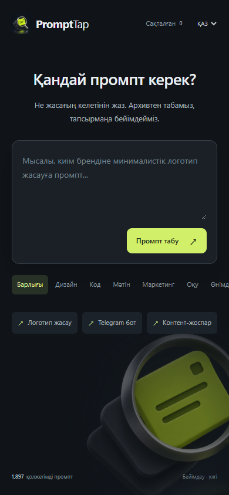

<p align="center">
  
</p>

<h1 align="center">PromptTap</h1>
<p align="center">Find the right prompt. Make it yours.</p>
<p align="center">Қазақша · Русский · English</p>
<p align="center">
  <a href="https://t.me/PromptTapBot">Open Telegram bot</a> ·
  <a href="#run-locally">Run locally</a> ·
  <a href="SECURITY.md">Security</a>
</p>
<p align="center">
  <a href="https://github.com/Vertex-blip/PromptTap/actions/workflows/checks.yml"></a>
  
  
</p>

PromptTap searches an imported prompt collection, preserves the original source, and prepares a prompt for the user's task when a close match is unavailable. The Telegram bot and responsive Mini App share the same search and adaptation service.


## What it does

| Feature | Behavior |
| --- | --- |
| Archive search | Up to three relevant matches, with multilingual query expansion |
| Original text | Full text, source paths, and complete UTF-8 downloads |
| Adaptation | AI rewriting when configured, clearly labeled task templates otherwise |
| Saved collection | User-scoped Telegram favorites and account-scoped Mini App bookmarks |
| Languages | Kazakh, Russian, and English interface |
| Multiple users | Bounded concurrent processing with ordered updates per user |

<p align="center"></p>

## Run locally

Use Node.js 22.13 or later. Importing RAR archives additionally requires PowerShell 7 and a `tar` build that supports RAR/7z, such as Windows' bundled bsdtar.

```sh
npm ci
```

Copy `.env.example` to `.env` and configure the Telegram token there. Put your archive at `jail_ai.rar`, then import and start.

```sh
npm run import
npm start
```

Open `http://127.0.0.1:3000` for the local Mini App preview. A configured Telegram token also starts the bot. Original archive files, imported catalogs, local databases, and credentials are excluded from Git.

An alternative archive path can be passed explicitly.

```sh
npm run import -- "D:/path/to/prompts.rar"
```

## Configuration

| Variable | Purpose |
| --- | --- |
| `TELEGRAM_BOT_TOKEN` | BotFather credential, required for Telegram and production authentication |
| `MINI_APP_URL` | Public HTTPS URL that opens from the bot |
| `AI_API_KEY` | Credential for AI adaptation |
| `AI_MODEL` | Model identifier, sample configuration uses `gemini-3.5-flash-lite` |
| `AI_BASE_URL` | OpenAI-compatible API endpoint, sample uses Gemini |
| `AI_DAILY_LIMIT` | Global generation-call budget per rolling 24-hour window, default 250 |
| `DATA_DIR` | Catalog and SQLite directory, default `./data` |
| `NODE_ENV` | Set `production` to require signed Telegram requests |
| `HOST`, `PORT` | Local preview defaults to `127.0.0.1:3000` |
| `TRUST_PROXY` | Exact trusted proxy address or subnet, empty by default |

The selected low-cost AI option is Gemini 3.5 Flash-Lite through Google's OpenAI-compatible endpoint. Obtain a key in Google AI Studio and put it in `AI_API_KEY`. Model availability and billing are controlled by the provider. Requests and the selected reference excerpt are sent to that provider during adaptation. Free-tier data handling differs from paid-tier handling. [Model documentation](https://aistudio.google.com/docs/models/gemini-3.5-flash-lite) · [API compatibility](https://aistudio.google.com/docs/openai) · [Pricing and data use](https://aistudio.google.com/docs/pricing)

Without an API key, search uses local indexing and multilingual vocabulary. A missing match produces a task-specific template. The interface identifies that mode. Local ranking is heuristic, and archive content varies in relevance and quality.

## Archive ingestion

The importer recursively reads nested archives, preserves source paths, and merges text duplicates by SHA-256. It streams content into a private catalog and never executes instructions found in files.

The supplied archive produced 3,135 unique records from 7,501 readable file occurrences across 36 archives. Of these, 1,238 are held for content review and 1,897 are eligible for retrieval. The report documents 32 skipped media, empty, binary, or oversized entries. Counts are specific to this import.

`data/import-report.json` records traversal limits, skipped entries, and deduplication. Limits include 8 archive levels, 30,000 entries, 8 MB per text file, 512 MB total text, and 3 GB of nested archive expansion. Content review is heuristic and needs ongoing human evaluation.

## Continuous hosting

The project includes a Docker image and Compose service for a continuously running Linux host with a persistent disk. A small Hetzner Cloud VM with at least 2 GB RAM is the selected hosting approach. Provisioning requires the owner's hosting account. [Hetzner Cloud](https://www.hetzner.com/cloud/)

On the host, copy `.env` and the generated `data/catalog.json` privately, make the data directory writable by container UID 1000, and run the service.

```sh
docker compose up -d --build
```

Compose binds HTTP to host loopback. Configure an HTTPS reverse proxy and a domain, set `MINI_APP_URL`, then restart the service. Set `TRUST_PROXY` to the actual proxy address seen inside the container. The Telegram bot can work through long polling before a Mini App URL is configured. Run one polling instance for each token.

The container runs as a non-root user with a read-only application filesystem, dropped capabilities, a writable data mount, and a health check. Back up the catalog and SQLite database together using a consistent SQLite backup. Production hosting and a live AI call remain pending until the external accounts are connected.

## Verification

```sh
npm run check
npm test
npm audit --omit=dev
node scripts/check-secrets.mjs
```

Tests cover Telegram commands, callback ownership, full downloads, parallel users, request limits, HMAC validation, production authentication, HTTP flows, record visibility, multilingual retrieval, adaptation failure, and concurrent generation reuse. GitHub Actions runs these checks on pushes and pull requests.

Live checks verified the Telegram identity, profile image, and localized descriptions. Browser checks cover search, opening originals, copying, downloading, saving, adaptation, and language changes at desktop and mobile widths. AI provider calls and Docker hosting require separate verification when credentials and hosting are connected.

To update the bot's public name, descriptions, and avatar after editing the branding assets, run the explicit setup command.

```sh
node scripts/setup-bot.mjs
```

The 3D brand artwork was generated with ImageGen from an original prompt describing a selected lime prompt card, graphite card stack, and silver magnifying glass. The owner approved the result.
