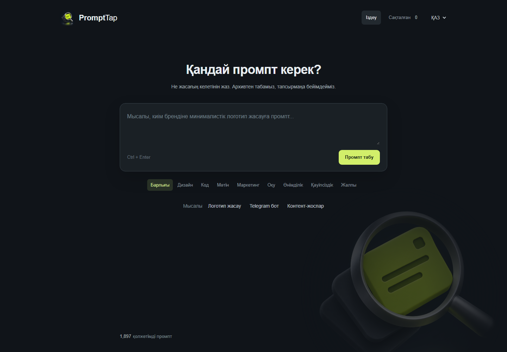
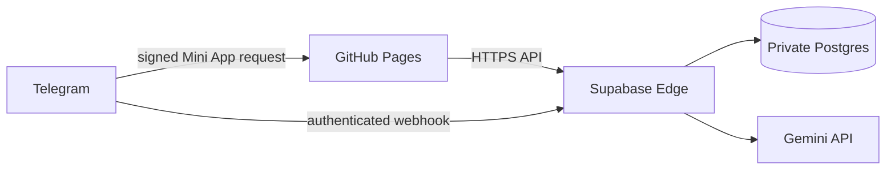

<p align="center">
  
</p>

<h1 align="center">PromptTap</h1>
<p align="center">Find the right prompt. Make it yours.</p>
<p align="center">Қазақша · Русский · English</p>
<p align="center">
  <a href="https://t.me/PromptTapBot">Open Telegram bot</a> ·
  <a href="https://vertex-blip.github.io/PromptTap/">Open website</a> ·
  <a href="#run-locally">Run locally</a> ·
  <a href="SECURITY.md">Security</a>
</p>
<p align="center">
  <a href="https://github.com/Vertex-blip/PromptTap/actions/workflows/checks.yml"></a>
  <a href="https://github.com/Vertex-blip/PromptTap/actions/workflows/pages.yml"></a>
  
</p>

PromptTap finds relevant prompts in an imported collection, keeps the original text and source, and adapts a prompt to the user's task. The Telegram bot and Mini App share search, retrieval, and Gemini adaptation.



## What it does

| Feature | Behavior |
| --- | --- |
| Archive search | Up to three relevant matches, with multilingual query expansion |
| Original text | Full text, source paths, and UTF-8 downloads |
| Adaptation | Gemini rewriting with a clearly labeled template fallback |
| Saved collection | Telegram favorites and account-scoped Mini App bookmarks |
| Languages | Kazakh, Russian, and English interface |
| Multiple users | Persistent request limits and per-user webhook processing leases |

Open the bot and use its **PromptTap** menu button to launch the Mini App. The website also opens in a normal browser and offers a Telegram entry button; search and adaptation require a verified Telegram session.

<p align="center"></p>

## Hosting

| Component | Location | Responsibility |
| --- | --- | --- |
| Website | [GitHub Pages](https://vertex-blip.github.io/PromptTap/) | Static interface and public URL configuration |
| API and bot | Supabase Edge Function `prompttap` | Telegram authentication, webhooks, search, and adaptation |
| Data | Private Postgres schema `prompttap_private` | Catalog, users, favorites, searches, quotas, and update leases |
| AI | Gemini API | Keyword expansion and task-specific prompts |



The API base is `https://jxfifiyzwcssledekqvk.supabase.co/functions/v1/prompttap`. `/health` reports that the function can respond; it does not verify database or model availability. `/api/meta` exposes catalog counts and configuration status. Prompt retrieval, downloads, search, and adaptation require signed Telegram data.

The Pages workflow publishes **only `public/`** after checks pass. Browser configuration contains public URLs only. API keys, bot credentials, the imported catalog, and the database remain outside the Pages artifact.

This deployment receives requests independently of a developer's computer. Free plans still have quotas and availability limits: Supabase may pause a Free project after low activity, Edge Functions have resource limits, and Gemini limits vary by project and model. There is no guaranteed continuous availability. See [Supabase availability](https://supabase.com/docs/guides/deployment/going-into-prod#availability), [function limits](https://supabase.com/docs/guides/functions/limits), [Gemini limits](https://aistudio.google.com/docs/rate-limits), and [GitHub Pages limits](https://docs.github.com/en/pages/getting-started-with-github-pages/github-pages-limits).

## Run locally

Use Node.js 22.13 or later. Importing RAR archives additionally requires PowerShell 7 and a `tar` build that supports RAR/7z, such as Windows' bundled bsdtar.

```sh
npm ci
```

Copy `.env.example` to `.env`. Leave `TELEGRAM_BOT_TOKEN` empty for a website-only preview, or use a separate development bot. Put the archive at `jail_ai.rar`, then import and start.

```sh
npm run import
npm start
```

Open `http://127.0.0.1:3000`. Local development uses the same-origin API, a local catalog, and SQLite. A configured token starts long polling; do not run polling against the deployed bot while its webhook is active. Archives, imported catalogs, databases, and `.env` are excluded from Git.

An alternative archive path can be passed explicitly.

```sh
npm run import -- "D:/path/to/prompts.rar"
```

## Configuration

| Variable | Purpose |
| --- | --- |
| `TELEGRAM_BOT_TOKEN` | BotFather credential; required for Telegram authentication |
| `MINI_APP_URL` | Public HTTPS URL opened by the bot |
| `AI_API_KEY` | Private credential for AI adaptation |
| `AI_MODEL` | Model identifier; current configuration uses `gemini-3.5-flash-lite` |
| `AI_BASE_URL` | OpenAI-compatible endpoint; current configuration uses Gemini |
| `AI_DAILY_LIMIT` | Generation-call budget per 24-hour quota window, default 250 |
| `SUPABASE_URL` | Project HTTPS origin for remote storage and catalog sync |
| `SUPABASE_PUBLISHABLE_KEY` | Optional project identifier for administrative tools; cannot call the private store RPC |
| `APP_STORE_SECRET` | Random private secret of at least 32 characters for store access and catalog administration |
| `TELEGRAM_WEBHOOK_SECRET` | Independent random secret checked on incoming Telegram webhooks |
| `DATA_DIR` | Local catalog and SQLite directory, default `./data` |
| `NODE_ENV` | Use `production` for a publicly hosted Node server |
| `HOST`, `PORT` | Local preview defaults to `127.0.0.1:3000` |
| `TRUST_PROXY` | Exact trusted reverse-proxy address or subnet for Node hosting |

The Node process reads its local environment. The Edge runtime uses Supabase's injected service-role credential to load backend settings from a restricted database function. It does not load a repository `.env` file. Bot, AI, application, and webhook secrets belong in private backend configuration, never in `public/config.js` or GitHub Pages settings.

Gemini receives the task and a bounded reference excerpt during adaptation. Model availability, billing, and data handling depend on the provider account. [API compatibility](https://aistudio.google.com/docs/openai) · [Pricing and data use](https://aistudio.google.com/docs/pricing)

Without a usable AI configuration, the app uses multilingual local ranking and task templates. Generated output identifies whether AI or a template produced it. Search ranking and content review are heuristic; results should be reviewed before use.

## Deploying changes

| Source | Deployment |
| --- | --- |
| `public/`, `.github/workflows/pages.yml` | GitHub Pages artifact on pushes to `main` |
| `edge/index.ts`, `edge/deno.json`, `src/` | Supabase Edge Function, with pinned Deno dependencies |
| `db/schema.sql` | Private tables, permissions, and restricted RPC functions |
| `scripts/sync-catalog.mjs` | Authenticated upload of the imported catalog |

For a new backend, apply the schema, provision private backend settings and the application-secret hash through an administrator connection, then deploy the `prompttap` function. Platform JWT verification must be disabled for this function because Telegram supplies its own authentication: the application verifies Mini App HMAC signatures and the webhook secret. Keep those checks enabled. Configure the Telegram webhook at `/webhook` with the same secret and set the bot's Mini App URL to the Pages URL. Stop any old polling instance before switching.

Once the site and backend are ready, register the webhook and Mini App menu using the private local configuration:

```sh
npm run setup:webhook
```

With `SUPABASE_URL` and `APP_STORE_SECRET` set privately, upload an imported catalog:

```sh
npm run sync:catalog
```

The script batches idempotent upserts and verifies the final record count. Catalog replacement does not delete older records automatically. Redeploy the function after changing the catalog or backend settings to refresh cached runtime state. Keep a private database backup independently of the public repository.

## Docker alternative

The included Docker image and Compose service run the Node application on a host with persistent storage. Copy `.env` and `data/catalog.json` privately, ensure the data directory is writable by container UID 1000, and run:

```sh
docker compose up -d --build
```

Compose binds HTTP to host loopback. For public access, configure HTTPS through a reverse proxy, use `NODE_ENV=production`, and set `TRUST_PROXY` to the actual proxy address. This mode uses SQLite and long polling, so disable the hosted webhook before moving the same bot to Docker. Run one polling instance per token. The container runs as a non-root user with a read-only application filesystem, dropped capabilities, a writable data mount, and a health check.

## Archive ingestion

The importer recursively reads nested archives, preserves source paths, and merges text duplicates by SHA-256. Imported text is data; the importer never executes instructions found in files.

The supplied archive produced 3,135 unique records from 7,501 readable file occurrences across 36 archives. Of these, 1,238 are held for content review and 1,897 are eligible for retrieval. The report documents 32 skipped media, empty, binary, or oversized entries. Counts are specific to this import.

`data/import-report.json` records skipped entries and deduplication. Limits include 8 archive levels, 30,000 entries, 8 MB per text file, 512 MB total text, and 3 GB of nested archive expansion. Content review requires ongoing human evaluation.

## Verification

```sh
npm run check
npm test
npm audit --omit=dev
npm run security
```

Tests cover authentication, webhook leases, callback ownership, downloads, request limits, private store behavior, multilingual retrieval, adaptation failures, and concurrent generation reuse. The secret scan checks tracked files for credential patterns and exact locally configured secret values, without printing those values. GitHub Actions runs release checks before publishing the website.

Backend checks on 23 November 2026 verified the imported record totals, signed search, exact original-text retrieval, downloads, Gemini adaptation with the source retained, isolation of review-held records, rejected unauthenticated requests, CORS, and duplicate-webhook handling. The 45-test suite passed, the production dependency audit reported no vulnerabilities, and database security advisors reported no warnings or errors. These are checks at that revision, not an ongoing security guarantee.

Browser verification covers desktop and mobile layouts, relative assets under `/PromptTap/`, the public Telegram entry, signed requests across origins, and expired-session recovery. New backend releases should repeat live search, adaptation, webhook, and authentication checks; a successful static deployment alone does not establish backend health.

To update the bot's public name, descriptions, and avatar after editing branding assets:

```sh
npm run setup:bot
```

The 3D brand artwork was generated with ImageGen from an original prompt describing a lime prompt card, graphite card stack, and silver magnifying glass. The owner approved the result.
